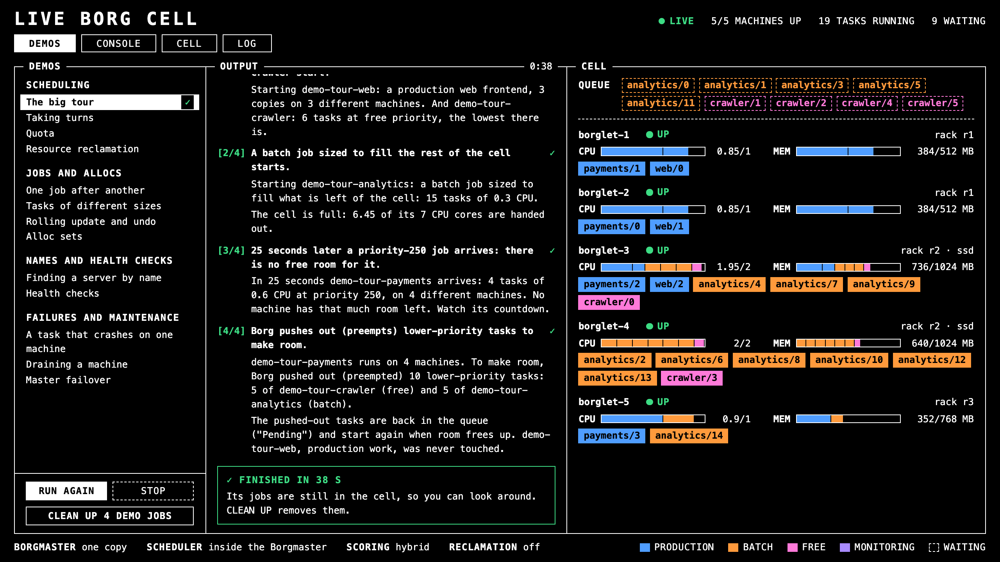
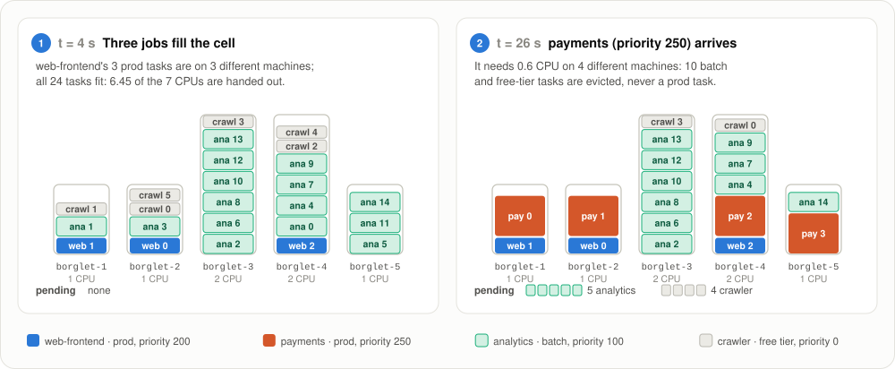
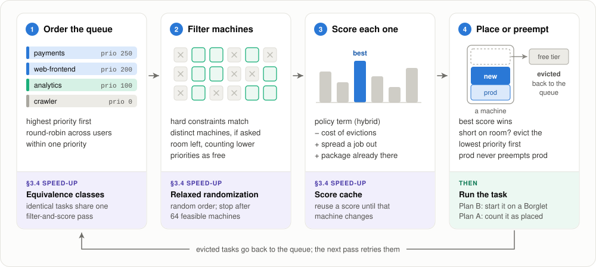
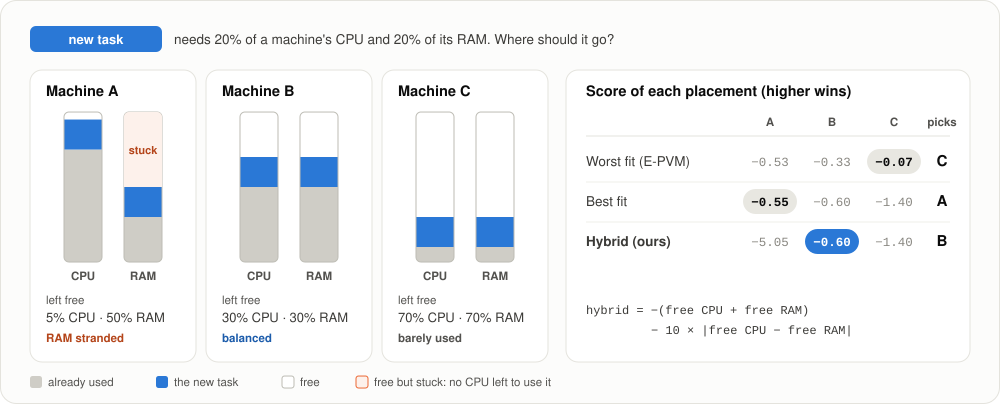
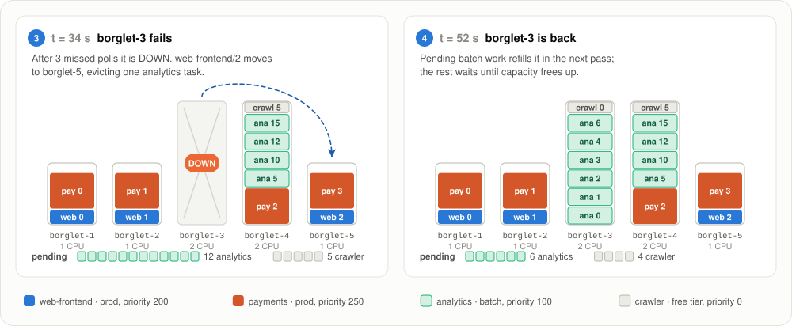
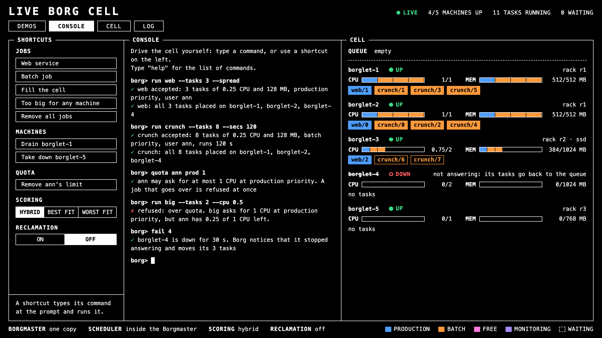

# Borg Scheduler

**The scheduler from Google's Borg paper, written in C++, running a small live cluster that you control from your browser.**

Borg is the system that runs almost all of Google's software. Google described it in [*Large-scale cluster management at Google with Borg*](https://research.google/pubs/large-scale-cluster-management-at-google-with-borg/) (Verma et al., EuroSys 2015), but has not released its code. This project implements Borg's scheduler from the paper, and enough of Borg around it to watch that scheduler work: a Borgmaster, five Borglet machines that run real processes, and a web page that shows every decision as it happens.



*The Live Borg Cell page at the end of the big tour: a production job has just pushed batch and free-tier tasks back into the queue.*

**Contents**

1. [Overview](#1-overview): what is in this repository, and Borg's terms
2. [Quick start](#2-quick-start): run the cell and try it
3. [The scheduler](#3-the-scheduler): what is in it, and how a task finds a machine
4. [The live cell](#4-the-live-cell): the Borgmaster, the Borglets, and what they do around the scheduler
5. [The page](#5-the-page): guided demos and the `borg>` prompt
6. [The simulator](#6-the-simulator): the same scheduler on thousands of machines
7. [Tests](#7-tests)
8. [What is covered, and what is not](#8-what-is-covered-and-what-is-not)
9. [Repository layout](#9-repository-layout)

## 1. Overview

### What is in this repository

| Part | What it is | Code |
|---|---|---|
| **The scheduler** | decides which machine runs each task: feasibility checks, three scoring policies, priorities and preemption, fair turns between users, the paper's three speed-ups and resource reclamation | `core/`, a C++17 library |
| **The live cell** | a Borgmaster, five Borglets and, optionally, the scheduler as a process of its own and five Borgmaster replicas. Every task is a real process, in its own Linux cgroup | `master/`, `borglet/` |
| **The page** | *Live Borg Cell*, a terminal-style web page: thirteen guided demos, a `borg>` prompt for driving the cell by hand, and the cell drawn live | `ui/` |
| **The simulator** | runs the same scheduler on a cell of thousands of machines, such as Google's public cluster trace | `sim/` |

### How it fits together


*One scheduler library, `core/`, is linked into three programs: the Borgmaster, the separate scheduler process and the simulator.*

### Borg in brief

Borg manages clusters of thousands of machines. Engineers say *what* to run; Borg decides *where* it runs and keeps it running. These terms are used throughout this README:

| Term | Meaning |
|---|---|
| **Cell** | a group of machines managed as one unit; a typical cell at Google has about 10,000 machines |
| **Job** and **task** | a job is a group of identical tasks; each task asks for some CPU, memory, disk and ports |
| **Priority** | every job has one. Long-running *production* (prod) services outrank *batch* work |
| **Borgmaster** | the central controller: it keeps the cell's state and decides where each task runs |
| **Borglet** | an agent on every machine: it starts and stops tasks and reports back when the Borgmaster polls it |
| **Preemption** | when the cell is full, a higher-priority task can evict lower-priority ones |
| **Quota** | how much a user may ask for at each priority; a job over quota is refused when it is submitted |
| **Alloc** | room reserved on a machine, which the tasks of several jobs can share |
| **Reclamation** | batch work may use resources that prod tasks have reserved but are not using |

## 2. Quick start

| You need | For |
|---|---|
| Docker, with Compose | the cell with Linux cgroups, so that CPU and memory limits are enforced by the kernel |
| a C++17 compiler and `make` | the cell without Docker, the simulator and the scheduler's unit tests |
| Node.js 22 or newer, and Chrome | the page's tests |
| Python 3 | the end-to-end test; with matplotlib, the simulator's charts |

### Run the cell

```bash
git clone https://github.com/cherie-dips/Borg-Scheduler.git
cd Borg-Scheduler
docker compose up --build -d     # builds one image and starts 1 Borgmaster and 5 Borglets
```

Open http://localhost:8080. `docker compose down` stops the cell and forgets its state.

Without Docker, the same cell runs as plain processes on your computer:

```bash
make                       # builds borgmaster, borgscheduler, borglet, borgsim and test_core into build/bin/
tools/cell.sh start        # 1 Borgmaster and 5 Borglets; open http://localhost:8080
tools/cell.sh stop
```

Without Linux cgroups, CPU limits are not enforced, and the Borglet checks memory limits itself and stops a task that goes over. Everything else works the same.

### Try it

1. **Run a guided demo.** On the **DEMOS** tab, *The big tour* is selected. Press **RUN**: three jobs fill the cell, then a priority-250 job arrives and pushes batch work out. [Section 3](#the-running-example) explains every step of it.
2. **Drive the cell yourself.** On the **CONSOLE** tab, type at the `borg>` prompt:

    ```text
    run web --tasks 3 --spread          a production service, one task per machine
    run crunch --tasks 8 --secs 120     a batch job that ends by itself after two minutes
    fail 3                              take borglet-3 down for 30 seconds
    help                                every command
    ```

3. **Kill the Borgmaster.** Start the cell with five Borgmaster replicas and a separate scheduler process, then kill the elected master: another replica takes over, and no task stops.

    ```bash
    tools/cell.sh start ha       # replicas on ports 8080-8084; it prints which page to open
    tools/cell.sh kill-master    # kill the elected master
    ```

## 3. The scheduler

The scheduler is a C++17 library of about 800 lines (`core/`). It knows nothing about networks or processes. It is given a `Cell`, which holds the machines and the tasks that are waiting or placed, and `Scheduler::schedule(cell)` makes one *pass* over the waiting tasks: it places the ones that fit, evicts lower-priority tasks where it has to, and returns what it did. The Borgmaster calls it every second. The separate scheduler process and the simulator call the same code.

### What the scheduler is given

| A task has | Meaning |
|---|---|
| a priority | a number; higher priorities are placed first and may evict lower ones |
| a request, its *limit* | CPU, RAM, disk and ports, each asked for on its own |
| a reservation | what the task is expected to really use; only resource reclamation looks at it |
| constraints | `key=value` pairs matched against a machine's attributes. A *hard* constraint must match; a *soft* one is only preferred |
| "distinct machines" | no two tasks of the job may share a machine |
| a package | the program it runs; a machine that already has it starts the task sooner |
| a user | users at the same priority take turns |
| an avoid list | the machines this task has crashed on |

A machine has a capacity (CPU, RAM, disk, ports), attributes such as `rack=r2` and `ssd=true`, the tasks placed on it, the packages already installed, and two flags: *up* and *draining*. It also has a version number that goes up whenever anything on it changes.

### What is in it

| Feature | What it does | Paper | Code (`core/`) |
|---|---|---|---|
| **Priority order** | waiting tasks are taken from the highest priority to the lowest | §3.2 | `Scheduler::schedule` |
| **Fair turns** | within one priority, users take turns and place one task per turn; who goes first changes every pass | §3.2 | `Scheduler::schedule` |
| **Feasibility** | keeps the machines that could run the task: up and not draining, hard constraints met, distinct machines respected, not a machine the task crashed on, and enough CPU, RAM, disk and ports | §3.2 | `Scheduler::feasible` |
| **Evictable room counts as free** | room held by tasks that this task may evict is counted as available | §3.2 | `Machine::committed`, `protected_from` |
| **Three scoring policies** | worst fit (E-PVM), best fit, and a hybrid that also keeps CPU and RAM in balance | §3.2 | `Scheduler::score`, `Policy` |
| **More score terms** | a cost for every eviction, spreading a job's tasks over machines, package locality, soft constraints, and mixing prod with non-prod work | §3.2 | `Scheduler::score` |
| **Preemption** | evicts the lowest priority first and, within one priority, the biggest task first; the victims go back to the queue | §3.2 | `victims`, `place_with_preemption` |
| **Prod never evicts prod** | tasks at production priority and above never evict each other | §2.5 | `protected_from` |
| **Equivalence classes** | identical tasks are checked and scored once, as a group | §3.4 | `class_key`, `group_pending` |
| **Score cache** | a score is kept until the machine changes | §3.4 | `cached_score` |
| **Relaxed randomization** | machines are examined in a random order until enough feasible ones are found | §3.4 | `find_candidates` |
| **Resource reclamation** | non-prod tasks are fitted against what the tasks on a machine are expected to use, not what they asked for | §5.5 | `use_reservations_for` |
| **Machine versions** | every placement reports the version of the machine it was decided for, so a scheduler working on a copy of the cell can be checked | §3.4 | `Placement::machine_version` |

The Borgmaster adds the parts of scheduling that need the whole cell: quota checks before a job is queued, delayed starts, allocs, ports, maintenance and failures. They are listed [after the walk-through](#around-the-pass-what-the-borgmaster-adds).

### The running example

The live cell has five machines, with 7 CPUs and 3.75 GB of RAM in total:

| Machine | CPU | RAM | Attributes |
|---|---|---|---|
| borglet-1, borglet-2 | 1 | 512 MB | `rack=r1`, `ssd=false` |
| borglet-3, borglet-4 | 2 | 1 GB | `rack=r2`, `ssd=true` |
| borglet-5 | 1 | 768 MB | `rack=r3`, `ssd=false` |

Four jobs are submitted, as in the page's *big tour*:

| Job | Priority | Tasks | What its tasks do |
|---|---|---|---|
| **web-frontend** | 200 (prod) | 3 × 0.25 CPU, 128 MB | run a service, each task on a different machine |
| **crawler** | 0 (free tier) | 6 × 0.2 CPU, 64 MB | sleep for 3 minutes |
| **analytics** | 100 (batch) | 15 × 0.3 CPU, 96 MB | sleep for 2.5 minutes. The job is sized to fill the cell: 15 tasks still fit here once the first two jobs are placed; in other runs it is 16 |
| **payments** | 250 (prod) | 4 × 0.6 CPU, 256 MB | run a service on 4 different machines; it arrives 25 seconds after the first job |

The pictures in this README show one real run of this example on the final build: (1) the three jobs placed, and (2) just after `payments` arrives. Placements can differ between runs. In particular, borglet-3 and borglet-4 are identical and may swap roles.



### One scheduling pass



*A pass has four steps. Evicted tasks go back to the queue and are placed again in a later pass.*

**Step 1: order the queue.** Waiting tasks are taken from the highest priority to the lowest. Within one priority, users take turns and place one task per turn (round-robin), so one user's huge job cannot take all the room or hold up everyone behind it. The user who goes first changes from pass to pass.

> **In the example:** later in the run a machine comes back empty while eleven `analytics` tasks (priority 100) and five `crawler` tasks (priority 0) are waiting. The pass takes `analytics` first: six of its tasks fill most of the machine, and one `crawler` task gets the room that is left ([frame 4](#example-a-machine-fails)).

**Step 2: keep the machines that could run the task (feasibility).** A machine qualifies if:

- it is up, and not being drained for maintenance;
- the task has not crashed on it before;
- it meets every *hard* constraint of the job, such as `ssd=true`;
- it does not already run a task of the same job, when the job asks for distinct machines;
- it has enough free CPU, RAM, disk and ports, counting the room of the tasks this task may evict as free.

> **In the example:** `web-frontend` asks for distinct machines, so its three tasks are on three different Borglets. When `payments` arrives, no machine has 0.6 CPU free, yet all five qualify: the batch and free-tier tasks on them count as free room, because `payments` may evict them.

**Step 3: score each machine.** The highest score wins:

```text
score = policy term                    worst fit, best fit or hybrid (see below)
      − 100 × (1 + 0.01 × priority)    for every task it would evict
      − spread weight × tasks          of the same job already on that machine
      + package bonus                  if the job's package is already there
      + 0.3                            for every soft constraint the machine meets
      + mix weight × share             of the machine's work that is in the other band
```

The eviction cost is far larger than every other term, so preemption is a last resort. When it is needed, the scheduler picks the machine with the fewest and lowest-priority victims. The last term prefers a mix of prod and non-prod work on each machine: for a prod task, "the other band" is the non-prod work already there, and the other way round. The weights are in the [settings](#settings).

> **In the example:** evicting a `crawler` task (priority 0) costs 100, and an `analytics` task (priority 100) costs 200. Making room for a `payments` task would cost 300 on borglet-1 (one of each), 400 on borglet-2, borglet-4 and borglet-5, and 500 on borglet-3 (one crawler task and two analytics tasks). So the four `payments` tasks go to borglet-1, 2, 4 and 5, and borglet-3 is left alone.

**Step 4: place the task, or preempt.** The task goes to the best machine. If that machine is short of room, tasks on it are evicted: the lowest priority first and, within one priority, the biggest first, until the new task fits. The evicted tasks go back to the queue.

> **In the example (frame 2):** ten tasks are evicted, five of `crawler` and five of `analytics`, and the prod `web-frontend` tasks are never touched. One second later, the next pass puts a waiting `crawler` task into the room that is left over on borglet-4.

The Borgmaster's event log (`GET /api/events`, or the page's **LOG** tab) records every decision. Times are seconds since the first job was submitted:

```text
 0.0s  schedule  web-frontend/0 -> borglet-2, port 20200
 0.0s  schedule  web-frontend/1 -> borglet-1, port 20100
 0.0s  schedule  web-frontend/2 -> borglet-4, port 20400
25.7s  preempt   crawler/1 preempted on borglet-1 by payments/0
25.7s  preempt   analytics/1 preempted on borglet-1 by payments/0
25.7s  schedule  payments/0 -> borglet-1, port 20101
26.7s  schedule  crawler/0 -> borglet-4
```

### The three scoring policies

The *policy term* of the score decides how tightly machines get packed. The paper compares three policies:

| Policy | Picks the machine where… | Effect |
|---|---|---|
| Worst fit (E-PVM) | the task adds the least to a cost that grows exponentially with use (e<sup>4 × use</sup>, for CPU and for RAM) | spreads load, leaving room on every machine |
| Best fit | the least CPU + RAM is left free | packs tightly, but can strand one resource |
| **Hybrid** (the default) | best fit, minus 10 × \|free CPU − free RAM\| | packs tightly and keeps CPU and RAM in balance |

"Free" means the share of the machine left after placing the task. A resource is *stranded* when it cannot be used because the other one has run out, such as spare RAM on a machine with no CPU left. The paper does not publish its hybrid formula, so this one is our own; its weight, 10, was chosen with the simulator's `alpha` experiment.



*The same new task, three candidate machines. The scores are what `Scheduler::score()` returns for this setup.*

- **Best fit** picks A, the tightest fit, but leaves half of A's RAM stranded: with no CPU left, no task can use it.
- **Worst fit** picks C, the emptiest machine. Spreading out like this can leave no machine with room for a big task later.
- **Hybrid** picks B. It still packs tightly, and B keeps 30% of each resource free for the next task.

The policy can be changed while the cell runs: `policy best-fit` at the `borg>` prompt, or `POST /api/config {"policy": "best_fit"}`.

### Who can evict whom

| Band | Priority | Can evict |
|---|---|---|
| Monitoring | 300 and above | non-prod tasks |
| Production (prod) | 200–299 | non-prod tasks, never another prod task |
| Batch | 100–199 | batch and free-tier tasks of lower priority |
| Free tier | below 100 | free-tier tasks of lower priority |

These are the live cell's bands; the page shows the free tier as FREE. The simulator uses the priorities of Google's trace, 0 to 11, where prod is 9 and above.

### Making it fast (§3.4)

A real cell has about 10,000 machines and thousands of waiting tasks, so checking every task against every machine is too slow. The scheduler uses the paper's three speed-ups:

| Speed-up | What it does |
|---|---|
| **Equivalence classes** | Tasks of one job with the same priority, request, constraints and package form a class. Feasibility and scores are worked out once for the class and kept in a heap, best machine first. Each task of the class takes the machine on top, and a machine is checked and scored again only if it changed since. |
| **Score cache** | A score is stored with the version of the machine it was computed for, and is used again until that version changes. |
| **Relaxed randomization** | Machines are visited in a random order, and the search stops after 64 machines that fit instead of looking at all of them. |

One more thing keeps a pass cheap: every machine keeps the totals of what its tasks ask for, one total per priority. A feasibility check then adds up a few numbers and never walks over the tasks.

Each speed-up can be switched off in `SchedulerConfig`. The unit tests run the scheduler with every combination of the three and check that every task is still placed and no machine is overfilled; the simulator's `scalability` experiment times each one.

### Resource reclamation (§5.5)

A task's *limit* is what it asked for, but most tasks use much less. With reclamation on, each task also has a *reservation*: what it is expected to use, plus a safety margin. Batch and free-tier tasks are then fitted against the reservations of the tasks already placed, not against their limits, so they can run in room that is reserved but idle. Prod tasks are always fitted against limits, so they never depend on borrowed room.

In the live cell reclamation is off until you turn it on (`reclaim on` at the `borg>` prompt). The Borgmaster then moves each task's reservation towards what the task really uses ([section 4](#reclamation-and-overload)).

### Around the pass: what the Borgmaster adds

Some of Borg's scheduling rules are not about picking a machine for one task. The Borgmaster (`master/main.cpp`) applies them before and after each pass:

| Feature | What it does | Paper | Code |
|---|---|---|---|
| **Admission control** | a job that would take its user over quota at its priority is refused when it is submitted; it never reaches the queue | §2.5 | `admit`, `set_quota` |
| **Tasks that are held back** | a job that starts later or after another job, and a crashed service waiting out its backoff, stay outside the queue until their time comes | §2.3 | `release_waiting` |
| **Allocs** | an alloc set is placed like a job and reserves room on machines; the tasks of the jobs inside it go into its allocs and move with them | §2.4 | `place_in_allocs` |
| **Ports** | ports are a resource the scheduler counts; the Borgmaster then picks the port numbers on the chosen machine | §2.3 | `assign_ports` |
| **Crash pairs** | a task that crashes on a machine is not placed on that machine again, unless it has crashed on all of them | §4 | `note_crash` |
| **Maintenance** | a draining machine takes no new tasks, and its tasks move away one per second, never too many of one job at once | §4 | `drain_step` |
| **Lost machines** | the tasks of a machine that stops answering go back to the queue, highest priority first, two per second | §4 | `on_missed_poll` |
| **Reservations follow usage** | with reclamation on, a task's reservation moves towards what it really uses | §5.5 | `update_reservation` |
| **Why is it waiting?** | every waiting task carries the reason: no machine is big enough or meets its constraints, or none has room at its priority | §2.6 | `no_fit_reason` |
| **A separate scheduler** | the pass can run in a process of its own, on a copy of the cell; the Borgmaster rejects any placement made for a machine that has changed since | §3.4 | `sched_state`, `sched_assign` |

### Settings

Everything the scheduler can be told is in `SchedulerConfig` (`core/include/borg/scheduler.h`):

| Setting | Default | Live cell | What it controls |
|---|---|---|---|
| `policy` | hybrid | hybrid | the scoring policy |
| `prod_min_priority` | 9 | 200 | where the production band starts |
| `equivalence_classes`, `score_cache`, `relaxed_randomization` | on | on | the three speed-ups |
| `sample_feasible` | 64 | 64 | how many feasible machines relaxed randomization looks for |
| `reclamation` | off | off | fit non-prod tasks against reservations |
| `w_preemption` | 100 | 100 | the cost of evicting one task |
| `w_spread` | 0.1 | 0.5 | the cost of each task of the same job already on the machine |
| `w_package` | 0.2 | 1.0 | the bonus when the package is already on the machine |
| `w_soft_constraint` | 0.3 | 0.3 | the bonus for each soft constraint that is met |
| `w_mix` | 0 | 0.2 | the bonus for mixing prod and non-prod work on a machine |
| `hybrid_alpha` | 10 | 10 | the weight of the imbalance term in the hybrid policy; 0 makes it best fit |
| `epvm_k` | 4 | 4 | how steeply the worst-fit cost grows with use |
| `seed` | 1 | 1 | the seed of the random machine order |

The simulator uses the defaults.

### Using the library

```cpp
#include "borg/scheduler.h"
using namespace borg;

Cell cell;
cell.add_machine("m1", {1.0, 512});                      // 1 CPU, 512 MB
cell.add_machine("m2", {2.0, 1024}, {{"ssd", "true"}});  // 2 CPUs, 1 GB, one attribute

Task batch;                                    // a batch task that takes most of m2
batch.job = 1; batch.user = "bob"; batch.priority = 4;
batch.limit = batch.reservation = {1.8, 900};
cell.add_task(batch);

Scheduler sched;                               // hybrid policy; prod starts at priority 9
sched.schedule(cell);                          // batch -> m2 (it does not fit on m1)

Task web;                                      // a prod task that needs a machine with an SSD
web.job = 2; web.user = "ann"; web.priority = 10;
web.limit = web.reservation = {0.5, 256};
web.constraints = {{"ssd", "true", true}};     // a hard constraint
cell.add_task(web);

ScheduleResult r = sched.schedule(cell);       // web -> m2, and the batch task is evicted
// r.placed    = [{task 2, machine m2}]
// r.preempted = [{victim: task 1, by: task 2}]; task 1 is pending again
```

Put it in a `main()` and build it with `c++ -std=c++17 -Icore/include example.cpp core/src/*.cpp`.

## 4. The live cell

The live cell runs that scheduler as a small, working cluster: the five machines of the example. `docker compose up` builds one image and starts six containers:

- the **Borgmaster**, on port 8080, which also serves the page;
- five **Borglets**, one per machine. Each runs privileged, with its own cgroup namespace, so that it can create one cgroup per task.

`tools/cell.sh start` runs the same cell without Docker, as plain processes. `tools/cell.sh start ha` runs it with five Borgmaster replicas and a separate scheduler process.

### What happens when you submit a job


*The page sends the job; within a second the scheduler places it, and the Borgmaster asks the chosen Borglet to start it. The Borgmaster polls every Borglet each second, and the page polls the Borgmaster.*

### The Borgmaster

The Borgmaster (`master/main.cpp`) keeps the cell's state in memory, records every change in its state store, and has four parts.

**1. A REST API**, used by the page and the tests.

<details>
<summary>The API, request by request</summary>

| Request | What it does |
|---|---|
| `GET /api/state` | machines, jobs and tasks, with their status, timestamps and usage |
| `GET /api/events?since=N` | the event log |
| `POST /api/jobs` | submit a job: `{name, user, type, priority, tasks, cpu, ram_mb, workload, constraints, distinct, delay or start_at}`, and optionally `{disk_mb, ports, after, overrides, appclass, slack_cpu, health, alloc_set}`. `type: "alloc"` submits an alloc set |
| `PATCH /api/jobs/<id>` | edit a job; a change that needs restarts is a rolling update: `rolling: {max_unavailable, max_disruptions}` |
| `POST /api/jobs/<id>/update` | `{action: "undo"}` or `{action: "commit"}` for the last update |
| `POST /api/jobs/<id>/poke` | reach into server tasks: `{action: sick, hang, ok, load or mem}` |
| `POST /api/jobs/<id>/reschedule` | move a waiting job's start, restart a live job, or run a finished job again |
| `DELETE /api/jobs/<id>[?purge=1]` | kill a live job (it stays in the history) or remove a finished one; `purge` does both |
| `POST /api/config` | switch the scoring policy, or turn reclamation on and off |
| `GET /api/quota`, `POST /api/quota` | list quotas; set or remove one: `{user, band, cpu, ram_mb, disk_mb}` |
| `GET /api/bns[?job=<name>]` | the name service: each task's name, machine, port and health |
| `POST /api/machines/<id>/fail` | simulate a machine failure for `{seconds}` |
| `POST /api/machines/<id>/drain`, `/undrain` | take a machine out for maintenance, and put it back |
| `POST /api/tasks/<id>/exec` | run a command inside a task's jail: `{cmd}` |
| `POST /api/register` | a Borglet joins the cell |

</details>

**2. The scheduler loop.** One pass every second, or sooner when something changes. Kills are sent before starts, so evicted tasks free their room first.

**3. The link shard.** It asks every Borglet for its `/status` every second, and passes a report on to the state only when it differs from the last one (§3.3). With replicas, each replica runs a shard and they share the Borglets between them.

- A machine that misses 3 polls in a row is marked **DOWN**, and its tasks go back to the queue: the highest priority first, two per second, because the machine may only be cut off and a big failure must not flood the scheduler (§4).
- When it answers again it is **UP**, and any stray task still running on it is killed.
- A started task that its Borglet has not reported for 6 s is **lost**, and is placed again.

**4. Job bookkeeping.**

- A service whose task fails or runs out of memory is restarted after a backoff of 1, 2, 4, … up to 30 s. A failed batch task stays failed.
- A job can start later (`delay` or `start_at`, up to 7 days ahead), or after another job (`after`). Its tasks wait outside the queue until then.
- Edits follow the paper (§2.3): a new priority applies in place; a new task count adds tasks or removes the highest-numbered ones; new resources, workload or constraints restart the tasks as a **rolling update**. At most `max_unavailable` tasks of the job are down at once (1 unless you say otherwise), the update stops after `max_disruptions` restarts, and until it is committed it can be undone, which rolls back only the tasks it touched.
- A task that crashes on a machine is not placed on that machine again (§4).
- A machine can be drained for maintenance: it takes no new tasks, and its tasks move away one per second, never more than `max_down` tasks of one job at a time.

### The Borglet

The Borglet (`borglet/`) runs the tasks on its machine.

- **API:** `POST /tasks` starts a task, `DELETE /tasks/<id>` stops it, `GET /status` reports, `POST /tasks/<id>/exec` runs a command in a task's jail, and `POST /admin/fail` simulates a failure.
- **Isolation:** every task gets its own cgroup v2, a Linux feature that limits the CPU and memory of a group of processes:
    - `cpu.max` caps the task's CPU at its limit, so busy loops are slowed down, not killed;
    - `memory.max` caps its RAM; going over it is an out-of-memory (OOM) kill, read from `memory.events`;
    - `memory.oom.group` makes an OOM kill stop the whole task, not just one thread;
    - `cpu.weight` gives latency-sensitive tasks (services) large shares of a busy machine's CPU and batch tasks tiny ones (§6.2). A job with `slack_cpu` has no hard cap and may use idle CPU beyond its limit.
- **Without cgroups** (outside Docker), the Borglet measures each task's CPU and memory itself, and stops a task that goes over its memory limit, as early Borglets did.
- **Ports:** the Borgmaster picks each task's ports from the machine's range and the Borglet passes them on (`BORG_PORT`). **Disk:** a task that writes more than its `disk_mb` is stopped.
- **Health checks (§2.6):** every 2 s the Borglet calls `GET /health` on each server task; after 3 failures in a row it stops the task, and the Borgmaster restarts it.
- **Memory pressure (§6.2):** if the tasks together use more memory than the machine has, the Borglet stops tasks from the lowest priority up, and the Borgmaster queues them again.
- **Jails (§6.1):** with `BORGLET_CHROOT=1` every task runs in a chroot jail as an unprivileged user.
- **Stopping:** a task gets SIGTERM first, then SIGKILL after 3 s.
- **Package locality:** the first task of a job on a machine spends 2 s *installing* its package; later ones start at once. The scheduler's package bonus prefers machines that already have it.
- **Workloads:** a task is the Borglet binary itself, run in worker mode, so the image needs no other programs.

<details>
<summary>The built-in workloads, and the Borglet's settings</summary>

| Workload | What the task does |
|---|---|
| `service` | runs until killed, with about 20 MB of memory and light periodic CPU. With a port it is a small web server: `/` answers, `/health` is its health check, `/load` and `/mem` cause a spike. Options: `unhealthy_after`, `hang_after`, `crash_on: <machine>` |
| `client` | calls the tasks of another job, which it finds by name: `{target, rps}` |
| `logsaver` | the helper next to a web server in the same alloc: it reads the server's request log from the alloc's shared directory |
| `disk` | writes `mb` MB into its directory |
| `sleep` | idles for `duration` seconds, then exits 0 |
| `cpu` | busy-loops `threads` threads for `duration` seconds |
| `mem` | grows to `mb` MB and holds it for `duration` seconds; over its limit, it is OOM-killed |
| `crash` | runs for `duration` seconds, then exits 1; with `only_on: <machine>` it crashes only there |

A Borglet reads its settings from the environment: `BORGLET_NAME`, `BORGLET_CPU`, `BORGLET_RAM_MB`, `BORGLET_DISK_MB`, `BORGLET_PORTS` (for example `20000-20031`), `BORGLET_ATTRS` (for example `rack=r1,ssd=true`), `BORG_MASTER` (one URL, or all replicas separated by commas), `BORGLET_INSTALL_SECS` and `BORGLET_CHROOT`.

</details>

### The life of a task


*The states the page shows. Preemption, a machine going down or a lost task send a task back to pending; services restart after a backoff.*

### Example: a machine fails

The running example continues. A few seconds after `payments` started, borglet-4 was taken down for 20 s (`fail 4 20` at the `borg>` prompt). It ran two prod tasks, `web-frontend/2` and `payments/2`.



- **34–37 s:** borglet-4 stops answering. After 3 missed polls the Borgmaster marks it DOWN and puts its 6 tasks back in the queue, the highest priority first, two per second.
- **37 s (frame 3):** `payments/2` comes first. It may not share a machine with another `payments` task, so only borglet-3 qualifies. Three lower-priority tasks are evicted there, and a waiting `crawler` task takes the 0.2 CPU that is left over.
- **38 s:** `web-frontend/2` follows. borglet-3 and borglet-5 qualify; borglet-5 needs one victim and borglet-3 two, so it goes to borglet-5.
- **54 s (frame 4):** borglet-4 answers again, and the next pass fills it with waiting work: six `analytics` tasks and one `crawler` task.

```text
34.3s  machine   borglet-4: failure injected for 20s
37.3s  machine   borglet-4 is DOWN (missed 3 polls); 6 task(s) rescheduled, 2 per second
37.3s  preempt   crawler/3 preempted on borglet-3 by payments/2
37.3s  preempt   analytics/2 preempted on borglet-3 by payments/2
37.3s  preempt   analytics/6 preempted on borglet-3 by payments/2
37.3s  schedule  payments/2 -> borglet-3, port 20300
37.3s  schedule  crawler/1 -> borglet-3
38.3s  preempt   analytics/14 preempted on borglet-5 by web-frontend/2
38.3s  schedule  web-frontend/2 -> borglet-5, port 20501
54.4s  machine   borglet-4 is back UP
54.4s  schedule  analytics/0 -> borglet-4
```

### Quota, names and health checks

- **Quota (§2.5).** A user can have a quota of CPU, RAM and disk in each priority band. A job that does not fit is rejected when it is submitted, with the reason; it never reaches the scheduler. The free tier (priorities below 100) needs no quota, and prod quota cannot add up to more than the cell has.
- **Names (§2.6).** Task 0 of job `web`, owned by `alice`, is called `0.web.alice.cc`. The name service (`GET /api/bns`) says which machine and port it is on now and whether it is healthy. A `client` task asks its Borglet, which asks the Borgmaster, so it keeps finding a server that has moved.

### Allocs

An alloc set is submitted like a job, with `type: "alloc"`: each of its allocs reserves CPU and RAM on a machine, used or not (§2.4). A job submitted with `alloc_set: <name>` runs inside it: task *i* goes into alloc *i*. Tasks of different jobs in one alloc share its resources and a directory, like a web server and its logsaver; on Linux the alloc is a parent cgroup. If the alloc moves to another machine, its tasks move with it.

### Reclamation and overload

With reclamation on (§5.5), a task's reservation starts at what it asked for. Twenty seconds after the task starts (five minutes in the paper), the reservation moves slowly towards what the task really uses plus a 25% margin, and jumps back up at once when the task uses more. Batch and free-tier tasks are then placed in the room that is reserved but idle. If the tasks on a machine later need more memory than it has, the Borglet stops the lowest-priority ones; prod tasks are never touched.

### Checkpoints, replicas, link shards and the scheduler process

- **Checkpoints (§3.1).** With `--state <dir>` the Borgmaster records every change to the cell's state in a change log, and writes the whole state as a snapshot now and then (`master/store.h`). Killed and started again, it reads both and carries on. The tasks on the machines never stop, and the next polls tell it what happened meanwhile.
- **Replicas (§3.1).** With `--replica <name>` as well, several Borgmasters share that state directory. The one that holds the lock in it is the elected master. The others follow the change log, pass API requests on to the elected master, and take the lock when it dies; the next one is elected within about a second. In the paper the store is replicated with Paxos and the lock is in Chubby; here both are one shared directory.
- **Link shards (§3.3).** Every replica polls a share of the Borglets and sends the elected master only the reports that changed.
- **The scheduler process (§3.4).** `borgscheduler` keeps a copy of the cell's state, fetches the changes, makes a scheduling pass and sends its assignments back. Each assignment names the version of the machine it was made for; the Borgmaster rejects it if the machine has changed since, and the scheduler looks at it again in its next pass. If no scheduler process is running, the Borgmaster schedules by itself.

```bash
tools/cell.sh start ha       # five replicas on ports 8080-8084, the scheduler process, five Borglets
tools/cell.sh kill-master    # kill the elected master: another replica takes over, no task stops
tools/cell.sh status         # what is running
```

`docker-compose.ha.yml` describes the same five-replica cell for Docker (`docker compose -f docker-compose.ha.yml up --build -d`). That file has not been run yet; see [Limits](#limits).

## 5. The page

The Borgmaster serves a web page, **Live Borg Cell** (`ui/`, plain ES modules, no build step). It looks like a terminal: white text on a black screen, with colour only for live things. A task has the colour of its priority band, and a machine's state is green, yellow or red. Everything fits one screen, in four tabs:

- **DEMOS:** three columns. On the left is the list of guided demos, in the middle the output of the selected one, and on the right the live cell.
- **CONSOLE:** the same screen driven by hand: shortcuts on the left, a `borg>` prompt in the middle, and the live cell on the right. The cell is the same one as on the DEMOS tab and is not redrawn when you switch.
- **CELL:** every number: the machines as a table (CPU and memory asked for, in use and reserved, ports, tasks), the jobs, the control plane (the Borgmaster and its replicas, the scheduler, the scoring policy) and the quotas.
- **LOG:** everything the Borgmaster did, newest first, with filters and a search box.

A line at the bottom of every tab shows the control plane and the colours of the priority bands.

The live cell draws every task as a block in its band's colour: production blue, batch orange, free pink, monitoring violet. A block slides from the queue to a machine when its task is placed, back when it is preempted, and to another machine when its machine fails.

### Guided demos

Select one and press **RUN**. Its steps are printed like the output of a command, in plain words, and they stay: you can scroll back and read an earlier step again. One demo runs at a time, and each step stays on screen for at least 5 seconds. **CLEAN UP** removes the demos' jobs (all named `demo-…`) and puts back anything they changed.

| Demo | What it shows | Paper |
|---|---|---|
| The big tour | fill the cell, then a priority-250 job preempts batch work | §3.2 |
| Taking turns | two users at the same priority share the room | §3.2 |
| Quota | a job over its user's quota is refused at once | §2.5 |
| Resource reclamation | batch work runs in room a prod job reserved but does not use, and is evicted when the prod job needs it | §5.5 |
| One job after another | a job starts only when another has finished | §2.3 |
| Tasks of different sizes | per-task overrides | §2.3 |
| Rolling update and undo | a change rolled out one task at a time, then undone | §2.3 |
| Alloc sets | two jobs share reserved room on a machine and move together | §2.4 |
| Finding a server by name | a client keeps reaching a server by its name after the server moves | §2.6 |
| Health checks | a server that stops answering its health check is replaced | §2.6 |
| A task that crashes on one machine | Borg stops placing it there | §4 |
| Draining a machine | maintenance without stopping the service | §4 |
| Master failover | you kill the elected master, another replica takes over, no task stops. Needs the cell with replicas: `tools/cell.sh start ha` | §3.1 |

`node tests/ui/demo-live.mjs http://localhost:8080 all` runs the same demos from a terminal; it leaves out *Master failover* on a cell without replicas.

### The console

You drive the cell yourself, by typing a command or by pressing a shortcut, which types its command at the prompt and runs it.



*Two jobs started, a third refused by a quota, and borglet-4 taken down: its three tasks have moved to borglet-3.*

| Command | What it does |
|---|---|
| `run <name> [--tasks N] [--cpu C] [--mem MB] [--prio prod\|batch\|free\|mon] [--user U] [--secs S] [--spread]` | starts a job; with `--secs` it is a batch job that ends by itself, and `--spread` puts at most one task on a machine |
| `rm <job>`, `rm all` | removes a job, or all of them |
| `jobs` | lists the jobs, and says why the ones that wait have no machine |
| `drain <machine>`, `undrain <machine>` | empties a machine for maintenance, and puts it back |
| `fail <machine> [seconds]` | takes a machine down as if it crashed (30 seconds unless you say otherwise) |
| `quota`, `quota <user> <band> <cpu>`, `quota <user> <band> off` | lists the quotas, sets one, removes one |
| `policy hybrid\|best-fit\|worst-fit` | changes the scoring policy |
| `reclaim on\|off` | turns resource reclamation on or off |
| `status`, `clear`, `help [command]` | the cell in a few lines; a clear screen; the list of commands |

A machine can be named in full or by its number (`drain borglet-2`, `drain 2`). A job gets 1 task of 0.25 CPU and 128 MB at production priority, owned by user `ann`, unless you say otherwise. The shortcuts cover the common cases: a web service, a batch job, a job that fills the cell, a task too big for any machine, draining a machine or taking one down, a quota for user `ann`, and the two scheduler settings.

## 6. The simulator

The live cell has five machines. `borgsim` (`sim/`) runs the same scheduler library on a cell of thousands, the way the paper's *Fauxmaster* does: it takes a snapshot of a workload, places every task with our scheduler, and measures the result.

It has two workloads:

- **Synthetic** (the default): a generated cell shaped like the paper's description, 2,000 machines unless you say otherwise (`--machines N`, `--fill F`).
- **Google's trace:** `tools/fetch_trace.sh` downloads a slice of [`clusterdata-2011-2`](https://github.com/google/cluster-data), the public trace the paper cites: the `machine_events` table and the first 6 of the 500 `task_events` files, about 8.5 hours of one cell (~11 MB). The snapshot at the end of that slice has 144,266 running tasks on 12,480 machines. The trace also records where Google placed each task; the simulator ignores that and places everything itself.

```bash
make
tools/fetch_trace.sh                                            # the trace slice, into data/trace
./build/bin/borgsim --workload trace --out build/results info   # the workload in a few lines
./build/bin/borgsim --workload trace --out build/results all    # every experiment, 11 seeds each
python3 tools/plot.py build/results                             # charts from the CSV files
./build/bin/borgsim --help                                      # every option
```

### Cell compaction

The paper measures a scheduler by the number of machines it needs: pack the same workload into smaller and smaller cells, and find the smallest one that still fits. Fewer machines means a better scheduler. The simulator's experiments are all measured this way (`sim/compaction.cpp`).


- **Smallest cell.** For a number of machines `n`, the whole workload is packed from scratch onto the first `n` machines of a shuffled list. It *fits* if at most 0.2% of the tasks are left waiting; the paper allows this for "picky" tasks with hard-to-meet constraints. A binary search finds the smallest `n` that fits. If the workload needs more machines than the cell has, machines are cloned, as in the paper.
- **Seeds.** Machines are removed in a random order, so the smaller cell keeps the same mix of machine types. This is repeated with 11 seeds, as in the paper, and the 90th percentile is reported.

### The experiments

Run one by name, or all of them with `all`. Each uses the hybrid policy unless it varies the policy.

| Name | What changes | Paper |
|---|---|---|
| `policies` | the scoring policy: worst fit, best fit or hybrid | §3.2 |
| `segregation` | one shared cell, or separate prod and non-prod cells; with and without reclamation | Fig.&nbsp;5 |
| `buckets` | exact requests, or requests rounded up to powers of two | Fig.&nbsp;8 |
| `reclamation` | non-prod tasks fitted against reservations, or against limits | Fig.&nbsp;10 |
| `scalability` | each §3.4 speed-up on or off, timing one pass | §3.4 |
| `alpha` | the hybrid policy's weight, from 0 (best fit) upwards | ours |

Without `--out`, `borgsim` writes into `results/`. That folder holds the output of an earlier run on the trace (CSV files, charts and the log), made with an earlier version of the scheduler. It is kept for reference, and this README does not quote it.

## 7. Tests

| Command | What it checks | Needs a running cell |
|---|---|---|
| `make test` | the scheduler: 20 unit tests | no |
| `node --test tests/ui/*.test.mjs` | the page's logic, the console's commands and the demo scripts against a fake cell: 31 tests | no |
| `node tests/ui/demo-live.mjs [url] [demo ...]` | runs the guided demos against a real cell, narrated in the terminal | yes |
| `python3 tests/e2e_cell.py [url] [section ...]` | the REST API, end to end: about 100 checks in a few minutes | yes |
| `node tests/ui/browser-smoke.mjs [url] [out-dir] [demo ...]` | the page in headless Chrome, with real clicks and keystrokes | yes |

The last two delete every job in the cell before they start.

<details>
<summary>What the end-to-end and browser tests check</summary>

`tests/e2e_cell.py` (name sections to run only some; see the top of the file):

- a delayed job waits for its start time, then starts on time;
- a priority edit applies in place: the tasks keep their machines and attempts;
- a CPU edit becomes a rolling update: one task down at a time; scaling down removes tasks;
- server tasks get ports and names, a client finds them by name, and a task that fails its health check is restarted;
- a job over its user's quota is rejected at submission; the free tier needs no quota; prod quota cannot be oversold;
- a job waits for another job to finish; a task runs with its own overridden request;
- a rolling update stops at its disruption limit, and undo rolls back only the tasks it touched;
- a task that crashes on a machine is not placed there again; draining a machine moves its tasks away one at a time;
- two users competing for the same room each get half;
- with reclamation, batch work runs in room a prod task reserved but does not use, and is evicted when the machine runs out of memory;
- tasks of two jobs share an alloc, read each other's files through it, and move with it when its machine fails;
- the Borgmaster restores its state after `kill -9` (needs `BORG_RESTART_CMD`), and with replicas another one takes over (needs `BORG_KILL_ELECTED_CMD`); the tasks never stop;
- duplicate job names are rejected with a clear error, a finished job can run again, and `purge` kills and removes a live job;
- prod tasks are spread over different machines;
- 25 batch tasks fill the cell to 100% CPU;
- a priority-250 job preempts exactly 4 batch tasks, and never a prod task;
- a task that allocates 128 MB under a 32 MB limit is OOM-killed by its cgroup (needs Docker);
- 0.25-core busy loops are throttled to 0.25 cores by `cpu.max` (needs Docker);
- a failed machine is marked DOWN after 3 missed polls, its prod task runs elsewhere about 3 s later, and the machine rejoins after the outage.

`tests/ui/browser-smoke.mjs` opens the page in a 1280×720 window, a small laptop or projector screen. It opens the four tabs and checks that each fits one screen and that nothing is wider than its pane. It presses **RUN** on the named demos (quota and tour by default) and checks that the steps fill in and keep their text, and that no other demo can start meanwhile. It then uses the console: it types a command that runs a job, has a second job refused by a quota, drains a machine with a shortcut, takes a machine down and changes a setting. It removes what it made, and fails on any console error.

</details>

## 8. What is covered, and what is not

The paper's features, section by section, and what this build does with each:

| Paper | Feature | In this build |
|---|---|---|
| §2.3 | jobs, tasks, hard and soft constraints, SIGTERM before SIGKILL | yes |
| §2.3 | a job that starts after another one finishes; per-task overrides | yes: `after`, `overrides` |
| §2.3 | each resource requested on its own: CPU, RAM, disk, ports | yes for disk space and ports; not disk speed |
| §2.3 | rolling updates with a disruption limit, undo | yes |
| §2.3 | the BCL configuration language | no |
| §2.4 | allocs and alloc sets | yes |
| §2.5 | priority bands, preemption, prod never preempts prod | yes |
| §2.5 | quota and admission control | yes; no prices and no administrator rights |
| §2.6 | task names (BNS) kept in Chubby | names and a lookup service in the Borgmaster; no DNS |
| §2.6 | health checks | yes |
| §2.6 | Sigma, "why pending?" | the page and the event log |
| §2.6 | log rotation, Infrastore | no |
| §3.1 | checkpoints: a snapshot plus a change log | yes |
| §3.1 | five replicas and an elected master | yes; a shared state directory and a lock stand in for the Paxos store and Chubby |
| §3.2 | feasibility, three scoring policies, preemption, package locality, mixing priorities | yes |
| §3.2 | spreading over racks and power domains | over machines only |
| §3.3 | polling the Borglets, machines going down and coming back, lost tasks | yes |
| §3.3 | link shards | yes, one per replica |
| §3.4 | the scheduler as a separate process, with optimistic concurrency | yes |
| §3.4 | score cache, equivalence classes, relaxed randomization | yes |
| §4 | maintenance (drain), slow rescheduling off lost machines, crash pairs | yes |
| §5.5 | resource reclamation | yes; off until turned on |
| §6.1 | chroot jails, `borgssh` | a jail per task and `exec`; written, not yet run (they need Linux) |
| §6.2 | cgroups, services served before batch, lowest priority evicted first when memory runs out | yes; the cgroup parts need Docker |

### Limits

- **The state store is one shared directory**, not a Paxos-replicated log, and the election is a file lock. A replica takes over when the elected master's process dies; a master that hangs without dying keeps the lock.
- **Requests to the Borglets go straight from the elected master**; the link shards carry only the reports.
- **Isolation needs Linux.** On macOS, cgroups exist only inside Docker's Linux VM. Run natively on a Mac, the Borglet has no CPU limits and checks memory limits itself.
- **Not yet run in Docker:** `cpu.weight` shares, the alloc's parent cgroup, chroot jails with `exec`, and `docker-compose.ha.yml`. They were written and tested as far as possible on a Mac without Docker; the end-to-end tests there cover everything else.
- **Task names have no DNS entries**, quota has no prices, and there are no administrator rights.

## 9. Repository layout

```text
core/          the scheduler library (Cell, Machine, Task, Scheduler), used by everything else
master/        the Borgmaster (REST API, job and machine state, replicas, link shards, checkpoints);
               borgscheduler, the scheduler as a process of its own; also serves the page
borglet/       the Borglet: one cgroup v2 per task, health checks, allocs and the built-in workloads
ui/            the Live Borg Cell page: plain ES modules, no build step
sim/           borgsim: trace loader, synthetic workloads, cell compaction and the experiments
tests/         scheduler unit tests, the page's tests, and the end-to-end and browser tests
tools/         cell.sh runs the live cell without Docker; fetch_trace.sh downloads the trace slice;
               plot.py draws the simulator's charts
results/       output of an earlier simulator run on Google's trace, kept for reference
assets/        the pictures in this README
docker/        the image used for the Borgmaster, the scheduler process and the Borglets
third_party/   cpp-httplib and nlohmann/json (header-only)
```

Where the rest of the paper lives in the code:

| Paper idea | Where it lives |
|---|---|
| The Borgmaster polls the Borglets and reschedules the tasks of machines that stop answering (§3.3) | `link_loop`, `on_status`, `on_missed_poll` in `master/main.cpp` |
| The Borglet starts and stops tasks and enforces their limits; SIGTERM, then SIGKILL (§2.3, §3.3) | `borglet/main.cpp`, `borglet/cgroups.cpp` |
| A job that starts after another, per-task overrides, rolling updates with undo (§2.3) | `release_waiting`, `spec_of`, `edit_job`, `roll` in `master/main.cpp` |
| Task names and health checks (§2.6) | `bns_json`; the Borglet's `health_loop` |
| Checkpoints: a snapshot plus a change log (§3.1) | `master/store.h`, `persist`, `restore` |
| Replicas and the elected master (§3.1) | `replica_loop`, `become_leader`, `forward` |
| Link shards (§3.3) | `link_plan`, `link_loop`, `link_report` |
| The scheduler as a separate process (§3.4) | `master/scheduler_main.cpp` |
| CPU shares for services and batch, evictions when memory runs out, chroot jails (§6) | `cpu_weight`, `control_locked`, `make_jail` in `borglet/main.cpp` |
| Cell compaction (§5.1) | `sim/compaction.cpp` |

---

**Reference.** A. Verma, L. Pedrosa, M. Korupolu, D. Oppenheimer, E. Tune and J. Wilkes. [*Large-scale cluster management at Google with Borg*](https://research.google/pubs/large-scale-cluster-management-at-google-with-borg/). EuroSys 2015.
