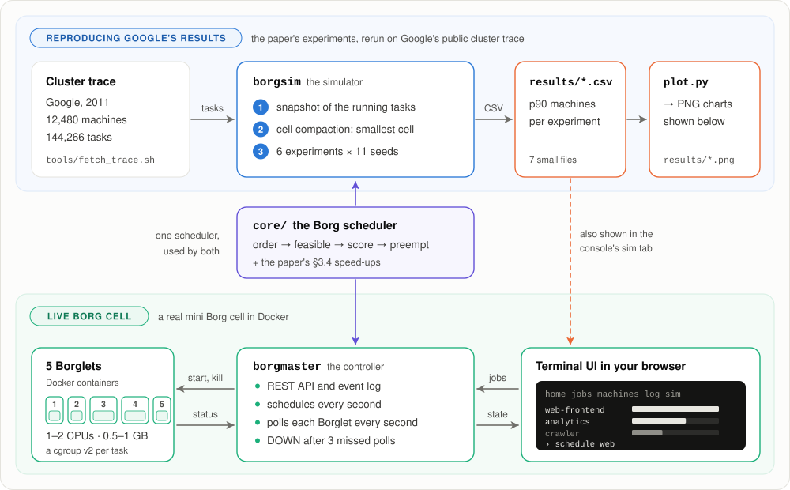
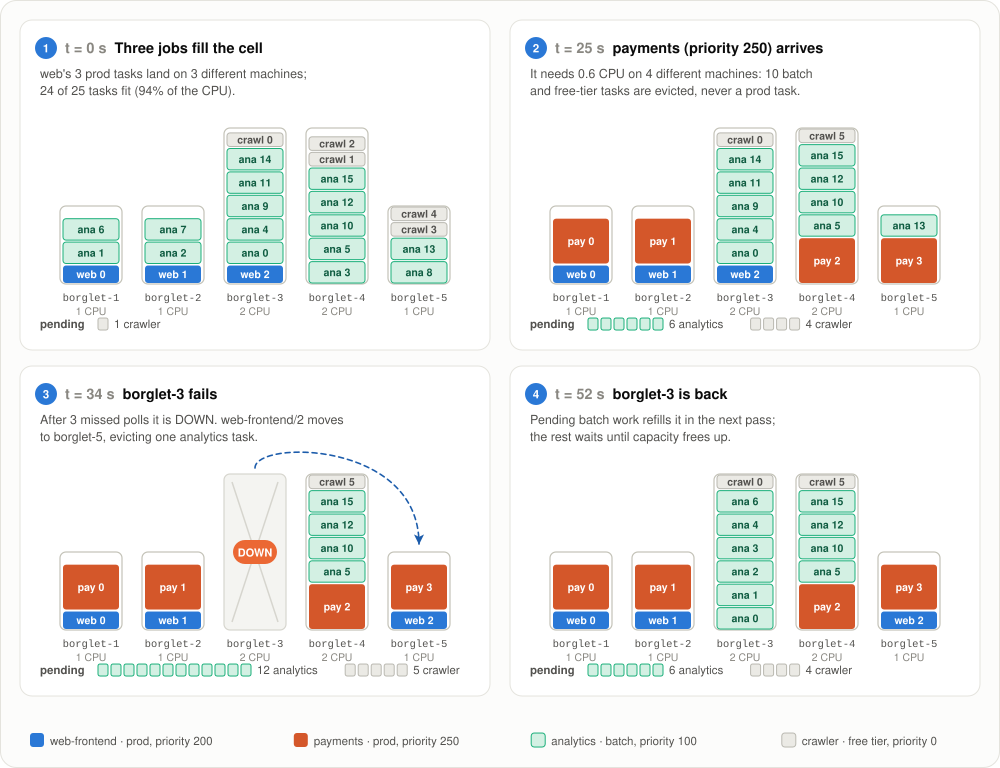
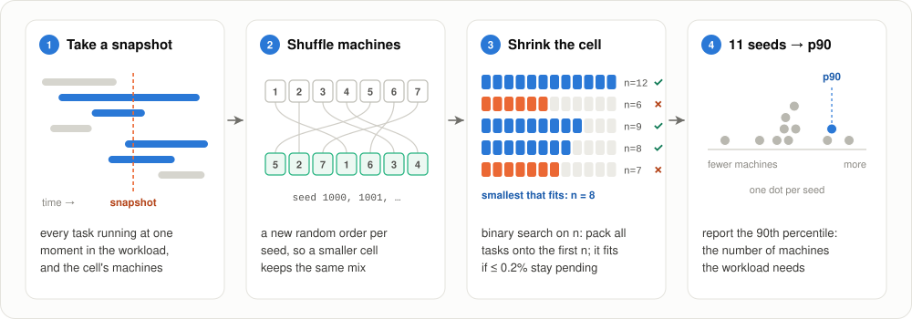
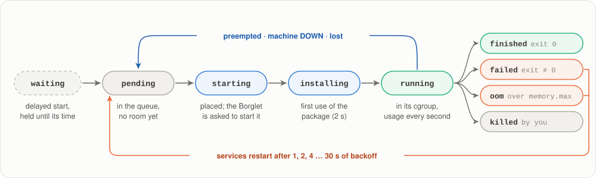
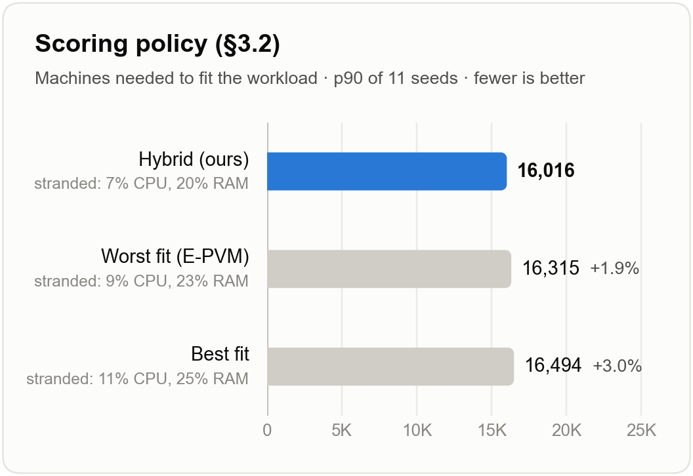
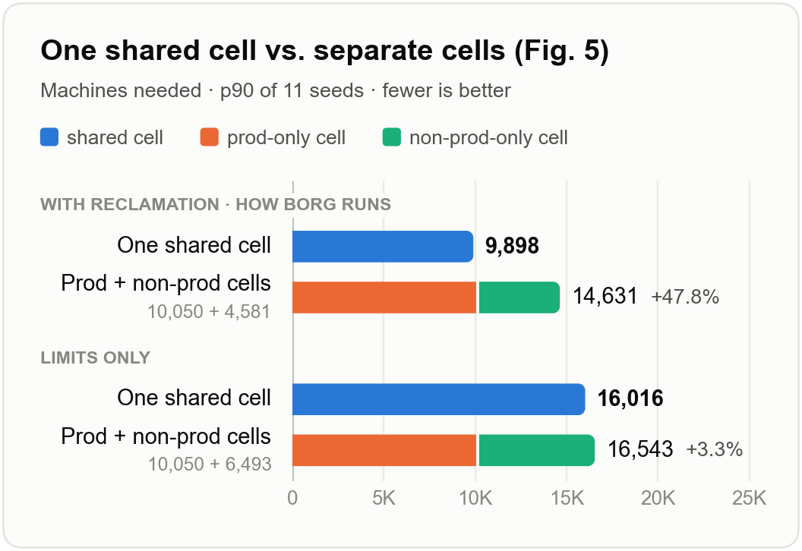
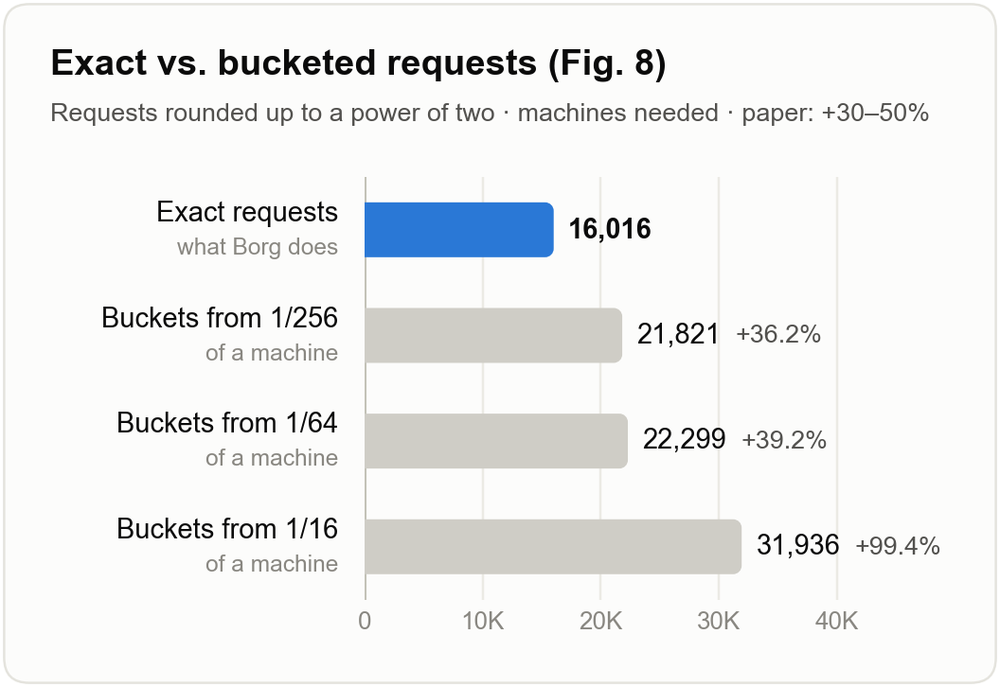
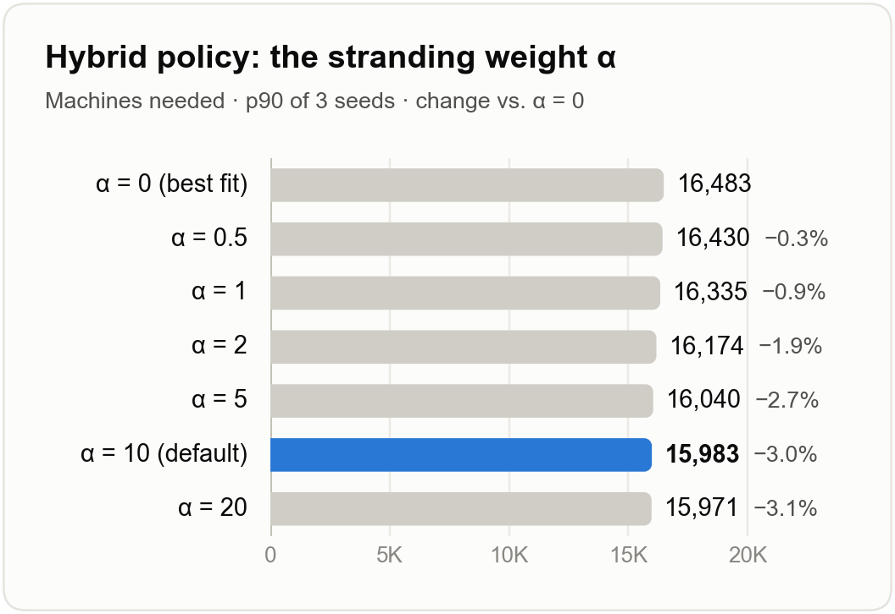
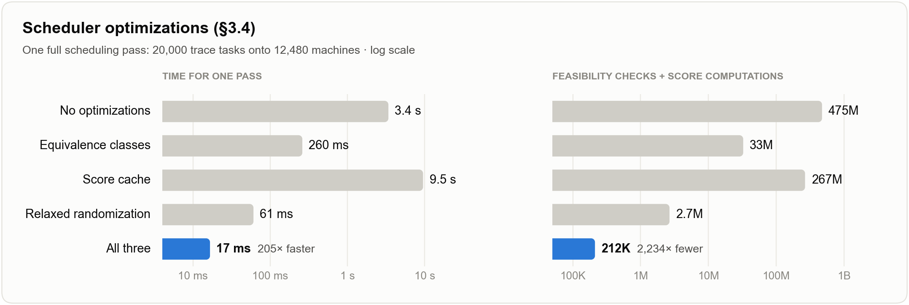

# Google-Borg

**Google's Borg scheduler, rebuilt in C++ and tested two ways: on Google's own cluster trace, and in a live five-machine cell that you drive from a terminal-style web console.**

This is a replication of the scheduling core of [*Large-scale cluster management at Google with Borg*](https://research.google/pubs/large-scale-cluster-management-at-google-with-borg/) (Verma et al., EuroSys 2015).



**Contents**
1. [What it is](#1-what-it-is)
2. [Quick start](#2-quick-start)
3. [Example: one cell under pressure](#3-example-one-cell-under-pressure)
4. [How the scheduler decides](#4-how-the-scheduler-decides)
5. [Plan A: replaying Google's trace](#5-plan-a-replaying-googles-trace)
6. [Plan B: a live mini Borg cell](#6-plan-b-a-live-mini-borg-cell)
7. [Results](#7-results)
8. [Code map, paper mapping and limitations](#8-code-map-paper-mapping-and-limitations)

## 1. What it is

**Borg in a nutshell.** Borg is the cluster manager that runs Google's workloads.
- A **cell** is a cluster of about 10,000 machines.
- Users submit **jobs**. A job is a set of identical **tasks**, and each task asks for some CPU and RAM and has a **priority**.
- A central **Borgmaster** decides which machine runs each task. An agent on every machine, the **Borglet**, starts and stops tasks and reports back when the master polls it.
- Two kinds of work share a cell: long-running, latency-sensitive **production (prod)** services, and **batch** work.
- When the cell is full, a higher-priority task can **preempt** (evict) lower-priority ones.

The paper's scheduling ideas, all implemented here:
- **Feasibility, then scoring** (§3.2): find the machines a task could run on, then pick the best one with a scoring policy.
- **Preemption by priority**, where prod never preempts prod.
- **Speed-ups** that make this fast enough for 10,000 machines (§3.4).
- **Resource reclamation** (§5.5): batch work runs in resources that prod tasks reserve but don't use.
- **Cell compaction** (§5), the evaluation method: how small a cell can a workload still fit into?

**What this repository builds**

| Part | What it does | Code |
|---|---|---|
| **The scheduler** | feasibility, three scoring policies, preemption, priority bands, the §3.4 speed-ups, reclamation | `core/` (a C++17 library) |
| **Plan A: simulation** | a simulator like the paper's Fauxmaster. It packs a snapshot of Google's 2011 cluster trace and runs cell compaction for six experiments | `sim/` → `borgsim` |
| **Plan B: live cell** | a real Borgmaster and five Borglets in Docker, with each task isolated in a cgroup v2, failure detection and a REST API | `master/`, `borglet/` |
| **Console** | a terminal-style web UI to schedule, edit, reschedule and delete jobs and watch the cell live | `ui/` |
| *Not built* | Paxos replication, naming (BNS, Chubby), the borgcfg language | out of scope |

**How the pieces fit** (the diagram above):
1. **Plan A** replays a slice of the public Google trace offline. `borgsim` takes a snapshot of every running task, then measures the smallest cell the workload fits into under different scheduler settings. The results go to `results/*.csv`, and `tools/plot.py` draws the charts in [Results](#7-results).
2. **Plan B** runs the same scheduler in a real, small cell. You submit jobs from the browser. The borgmaster places them on Borglet containers, which run each task in its own cgroup.
3. Both plans link the same `core/` library. The code behind the experiment numbers is the code that places your tasks in the live cell.

**Headline results**
- Our hybrid scoring policy needs **2.9% fewer machines** than best fit (paper: 3–5%).
- Splitting prod and batch into separate cells needs **48% more machines**, with reclamation on (paper: 20–30% more).
- The §3.4 speed-ups make one scheduling pass **about 200× faster**: 3.4 s → 17 ms.
- The live cell passes **28 end-to-end checks**: placement, preemption, OOM kills, CPU throttling and failure recovery.

## 2. Quick start

**You need:**
- a C++17 compiler and `make`;
- Docker Desktop, for Plan B;
- Python 3 with matplotlib, only to redraw the charts;
- Node.js 18+ and Chrome, only for the UI tests.

```bash
make            # builds borgsim, borgmaster, borglet and test_core into build/bin/
make test       # 14 scheduler unit tests
```

**Plan A: run the experiments**

```bash
tools/fetch_trace.sh                       # ~11 MB slice of Google's 2011 trace into data/trace
./build/bin/borgsim --workload trace all   # all six experiments, 11 seeds each (~15 min)
python3 tools/plot.py                      # results/*.csv -> results/*.png
```

- **No trace?** `./build/bin/borgsim all` uses a synthetic workload instead (`--machines N`, `--fill F`).
- **One experiment at a time:** name it, e.g. `./build/bin/borgsim --workload trace policies buckets`.
- **All options:** `./build/bin/borgsim --help`.

**Plan B: start the live cell**

```bash
docker compose up --build -d     # 1 borgmaster + 5 Borglets
open http://localhost:8080       # the console
```

Then type `:tour` (see the [example](#3-example-one-cell-under-pressure)). Stop everything with `docker compose down`.

**Without Docker** everything works except cgroup isolation, which needs Linux:

```bash
./build/bin/borgmaster --port 8080 &
BORGLET_NAME=b1 BORGLET_PORT=9091 BORGLET_ADVERTISE=http://localhost:9091 ./build/bin/borglet &
BORGLET_NAME=b2 BORGLET_PORT=9092 BORGLET_ADVERTISE=http://localhost:9092 ./build/bin/borglet &
```

Borglet settings: `BORGLET_CPU`, `BORGLET_RAM_MB`, `BORGLET_ATTRS=rack=r1,ssd=true`, `BORG_MASTER`, `BORGLET_INSTALL_SECS`.

**Tests**

```bash
node --test tests/ui/*.test.mjs     # UI logic: 45 tests, no cell needed
python3 tests/e2e_cell.py           # the REST API end to end: 28 checks, ~45 s
node tests/ui/browser-smoke.mjs     # the console in headless Chrome: 19 steps
```

The last two need a running cell, and they delete every job in it first.

## 3. Example: one cell under pressure

The live cell has five machines, 7 CPUs and 3.75 GB in total:

| Machine | CPU | RAM | Attributes |
|---|---|---|---|
| borglet-1, borglet-2 | 1 | 512 MB | `rack=r1` |
| borglet-3, borglet-4 | 2 | 1 GB | `rack=r2`, `ssd=true` |
| borglet-5 | 1 | 768 MB | `rack=r3` |

Typing `:tour` in the console submits four jobs:

| Job | Priority | Tasks | What they do |
|---|---|---|---|
| **web-frontend** | 200 (prod) | 3 × 0.25 CPU, 128 MB | a service; tasks on different machines |
| **crawler** | 0 (free tier) | 6 × 0.2 CPU, 64 MB | sleep for 3 minutes |
| **analytics** | 100 (batch) | 16 × 0.3 CPU, 96 MB | CPU loops for 2 minutes; fills the cell |
| **payments** | 250 (prod) | 4 × 0.6 CPU, 256 MB | a service on 4 machines; starts at 25 s |

Six seconds after `payments` starts, we failed a machine for 20 s (`fail borglet-3`, or press `3`, select it and press `f`). These are four real snapshots of that run (exact placements can differ a little from run to run):



**What happened, and why:**
1. **0 s: the cell fills up.** Higher priorities are placed first, so `analytics` (100) goes before `crawler` (0). `web-frontend` asked for distinct machines, so its three tasks land on three different Borglets. 24 of the 25 tasks fit. One crawler task waits in the queue: *no machine has enough free resources at this priority*.
2. **25 s: `payments` arrives.** No machine has 0.6 CPU free.
   - Feasibility counts lower-priority tasks as free space, so every machine qualifies.
   - Scoring then charges about 100 points per task to evict. It picks the machines that need the fewest and lowest-priority victims: borglet-1 and borglet-2 (two victims each), then borglet-4 and borglet-5 (three each, mostly crawler tasks).
   - The 10 victims go back to the pending queue. The prod `web-frontend` tasks are never touched, because prod never preempts prod.
   - The space left over on borglet-4 lets the waiting crawler task start.
3. **31–34 s: borglet-3 fails.** It stops answering polls. After 3 missed polls the master marks it DOWN and puts its 7 tasks back in the queue.
   - `web-frontend/2` is prod and needs a machine without another web task, so only borglet-4 and borglet-5 qualify.
   - borglet-5 needs only one victim, so one `analytics` task is evicted there.
4. **52 s: borglet-3 is back.** It answers polls again, and the next pass fills it with pending batch work.

The console's log view (key `4`) shows these decisions as they happen. An excerpt from the same run, with times since the jobs were submitted:

```text
 0.0s  schedule  web-frontend/0 -> borglet-1
 0.0s  schedule  web-frontend/1 -> borglet-2
 0.0s  schedule  web-frontend/2 -> borglet-3
25.1s  preempt   analytics/1 preempted on borglet-1 by payments/0
25.1s  preempt   crawler/1 preempted on borglet-4 by payments/2
25.1s  schedule  payments/2 -> borglet-4
25.1s  schedule  crawler/5 -> borglet-4
34.0s  machine   borglet-3 is DOWN (missed 3 polls); 7 task(s) rescheduled
34.0s  preempt   analytics/13 preempted on borglet-5 by web-frontend/2
34.0s  schedule  web-frontend/2 -> borglet-5
52.1s  machine   borglet-3 is back UP
52.1s  schedule  analytics/0 -> borglet-3
```

## 4. How the scheduler decides

`core/` is a small C++17 library: a `Cell` holds machines and tasks, and `Scheduler::schedule(cell)` makes one pass over the pending queue. Both plans call it: `borgsim` to pack the trace, and the borgmaster once a second.


**1. Order the queue.** Pending tasks go from the highest priority to the lowest. Within one priority, users take turns (round-robin), so one user's huge job can't block everyone else.

**2. Filter the machines (feasibility).** A machine is feasible for a task if:
- it is up;
- it matches every *hard* constraint, such as `ssd=true`;
- it doesn't already run a task of the same job, if the job asked for distinct machines;
- it has room for the task's CPU and RAM, counting the resources of tasks this task may evict as free.

**3. Score each feasible machine.** The highest score wins:

```text
score = policy term                       worst fit, best fit or hybrid (below)
      − 100 × (1 + 0.01 × priority)       for every task it would evict
      − spread weight × tasks             of the same job already on that machine
      + package bonus                     if the job's package is already there
      + 0.3                               for every soft constraint it satisfies
```

The spread weight is 0.1 in Plan A and 0.5 in the live cell, and the package bonus is 0.2 and 1.0. The eviction cost is much larger than any other term. Preemption is a last resort, and when it is needed the scheduler picks the fewest and lowest-priority victims.

**4. Place, or preempt.** The task goes to the best machine. If that machine is short of room, tasks are evicted lowest priority first, and the biggest first within a priority. They go back to the queue for the next pass.

**Priorities.** Who can evict whom, in the live cell:

| Band | Priority | Can evict |
|---|---|---|
| monitoring | 300 and up | non-prod tasks |
| production (prod) | 200–299 | non-prod tasks, never another prod task |
| batch | 100–199 | batch and free-tier tasks of lower priority |
| free tier | below 100 | free-tier tasks of lower priority |

In Plan A the trace's priorities run from 0 to 11, and prod is 9 and up.

**Scoring policies.** The paper compares three policies:

| Policy | Prefers the machine where… | Effect |
|---|---|---|
| Worst fit (E-PVM) | the task adds the least to a cost that grows exponentially with use (e<sup>4 × use</sup>, for CPU and for RAM) | spreads load, keeping room free on every machine |
| Best fit | the least CPU + RAM stays free | packs machines tightly, but can leave one resource stranded |
| **Hybrid** (default) | best fit, minus 10 × \|free CPU − free RAM\| | packs tightly and keeps CPU and RAM in balance |

"Free" means the fraction of the machine left after placing the task.

The paper doesn't publish its hybrid formula, so this one is our own design. It is best fit plus a penalty for leaving a machine with lots of one resource and none of the other: that leftover is *stranded*, because no task can use it. We chose the weight α = 10 with a sweep (see [Results](#7-results)).

Here is the difference on one example. The scores are what `Scheduler::score()` returns for this exact setup:


- **Best fit** picks A, the tightest fit. A is left with 5% CPU and 50% RAM. That RAM is stranded: with no CPU left, no task can use it.
- **Worst fit** picks C, the emptiest machine. It spreads work over every machine, so a big task may later find no machine with enough room left.
- **Hybrid** picks B. It still packs tightly, and B keeps 30% of each resource free, which the next task can use.

**The §3.4 speed-ups.** Without them, one pass over 20,000 tasks checks every task against every machine.
- **Equivalence classes:** tasks of one job with the same requirements are filtered and scored once, as a group. The group then takes machines from a heap; a machine is re-scored only if it changed since it was scored.
- **Score cache:** a score is kept until its machine changes. Each machine has a version number that goes up when its tasks change.
- **Relaxed randomization:** machines are visited in a random order (a random start and a random stride), and the search stops after 64 feasible machines instead of checking them all.

**Resource reclamation (§5.5).** A task's *limit* is what it asked for. Most tasks use much less. The Borgmaster estimates a *reservation* for each task (its real usage plus a safety margin), and fits non-prod tasks against the reservations of the tasks already placed, instead of their limits. Prod tasks are always fitted against limits. Plan A uses reclamation in two of its experiments; the live cell fits every task against its limits.

## 5. Plan A: replaying Google's trace

The paper evaluated Borg's scheduler offline, with the Fauxmaster: the real scheduler code run against a recorded state of a cell. `borgsim` does the same with the public trace the paper cites.

**The data.** `tools/fetch_trace.sh` downloads `machine_events` and the first 6 of the 500 `task_events` files of [`clusterdata-2011-2`](https://github.com/google/cluster-data). That is about 8.5 hours of a month of one cell, ~11 MB. `borgsim` replays the events up to the end of that slice (t = 30,666 s) and keeps every task still running at that moment:
- 12,480 machines;
- 144,266 tasks, 55,782 of them prod.

CPU and RAM are normalized in the trace (0 to 1, relative to the largest machine), so results are relative, not cores or GB. The running tasks request 116% of the cell's CPU, because the real Borg overcommits. So the workload needs more machines than the original 12,480, and compaction clones machines to get them, as the paper does.

**Measuring a scheduler: cell compaction.** Every chart in this README reports *machines needed*, computed this way:



- **Smallest cell.** For a given number of machines `n`, the whole workload is packed from scratch onto the first `n` machines of the shuffled list. It *fits* if at most 0.2% of the tasks are left pending; the paper allows this for "picky" tasks with hard-to-meet constraints. A binary search finds the smallest `n` that fits.
- **Seeds.** Removing machines in a random order keeps the smaller cell's mix of machine types the same. We run 11 seeds (1000, 1001, …), as the paper does, and report the 90th percentile.

**The experiments.** Run one with `./build/bin/borgsim --workload trace <name>`, or all of them with `all`.

| Name | What changes | Paper |
|---|---|---|
| `policies` | the scoring policy: worst fit, best fit or hybrid | §3.2 |
| `segregation` | one shared cell, or separate prod and non-prod cells; with and without reclamation | Fig.&nbsp;5 |
| `buckets` | exact requests, or requests rounded up to powers of two, with a smallest bucket of 1/256, 1/64 or 1/16 of a machine | Fig.&nbsp;8 |
| `reclamation` | non-prod tasks fitted against reservations, or against limits | Fig.&nbsp;10 |
| `scalability` | each §3.4 speed-up on or off, timing one pass of 20,000 tasks | §3.4 |
| `alpha` | the hybrid's stranding weight, from 0 (best fit) to 20, with 3 seeds | ours |

Every experiment uses the hybrid policy unless it varies the policy.

- **Reservations.** The trace's huge `task_usage` table isn't loaded, so reservations come from a usage model shaped like the paper's Fig. 11. Prod tasks use 15–60% of their CPU limit and 40–80% of their RAM limit; non-prod tasks use 30–90% and 50–90%. A 10% safety margin is added. On the trace this makes reservations about 51% of the CPU limits and 70% of the RAM limits.
- **Synthetic workload.** `--workload synthetic` (the default) generates a cell shaped like the paper's description: mixed machine types, prod services with spreading constraints, and many small batch tasks. It is used for quick runs and the tests.

## 6. Plan B: a live mini Borg cell

`docker compose up` builds one image and starts six containers:
- the **borgmaster**, on port 8080, which also serves the console and the Plan A results;
- five **Borglets**, sized as in the [example](#3-example-one-cell-under-pressure).

Each Borglet runs privileged, with a private cgroup namespace, so that it can create one cgroup per task. The borgmaster runs the `core/` scheduler on its in-memory state.

**What happens when you submit a job:**


**The borgmaster** (`master/main.cpp`)
- **REST API:**

  | Request | Does |
  |---|---|
  | `GET /api/state` | machines, jobs and tasks, with status, timestamps and usage |
  | `GET /api/events?since=N` | the event log |
  | `POST /api/jobs` | submit `{name, user, type, priority, tasks, cpu, ram_mb, workload, constraints, distinct, delay or start_at}` |
  | `PATCH /api/jobs/<id>` | edit a job |
  | `POST /api/jobs/<id>/reschedule` | move a waiting job's start, restart a live job, or run a finished job again |
  | `DELETE /api/jobs/<id>[?purge=1]` | kill a live job (it stays in the history), or remove a finished one; `purge` does both |
  | `POST /api/config` | switch the scoring policy |
  | `POST /api/machines/<id>/fail` | simulate a machine failure for `{seconds}` |
  | `POST /api/register` | a Borglet joins the cell |
- **Scheduler loop:** one pass every second, or sooner when something changes. Kills are sent before starts, so evicted tasks free their room first.
- **Poller:** asks every Borglet for `/status` every second.
  - A machine that misses 3 polls in a row is **DOWN**, and its tasks go back to the queue.
  - When it answers again it is **UP**, and any stray task still running on it is killed.
  - A started task that its Borglet hasn't reported for 6 s is **lost**, and is rescheduled.
- **Restarts:** a service whose task fails or is OOM-killed is restarted after a backoff of 1, 2, 4, … up to 30 s. A failed batch task stays failed.
- **Delayed starts:** `delay` or `start_at`, up to 7 days ahead. The tasks wait outside the queue until then.
- **Edits** follow the paper (§2.3). A new priority applies in place. New resources, workload or constraints restart the tasks. A new task count adds tasks or removes the highest-numbered ones.
- State lives in memory only (no Paxos). If the master restarts, the Borglets register again by themselves.

**The Borglet** (`borglet/`)
- **API:** `POST /tasks` starts a task, `DELETE /tasks/<id>` stops it, `GET /status` reports, `POST /admin/fail` simulates a failure.
- **Isolation:** each task gets its own cgroup v2.
  - `cpu.max` caps its CPU at its limit. Busy loops are throttled, not killed.
  - `memory.max` caps its RAM. Going over it is an OOM kill, read from `memory.events`.
  - `memory.oom.group` kills the whole task, not just one thread.
- **Stopping:** SIGTERM first, then SIGKILL after 3 s.
- **Package locality:** the first task of a job on a machine spends 2 s *installing* its package; later ones start at once. The scheduler's package bonus prefers machines that already have it.
- **Workloads:** a task is the Borglet binary re-run in worker mode, so the image needs no other programs.

  | Workload | Behaviour |
  |---|---|
  | `service` | runs until killed: ~20 MB of memory, light periodic CPU |
  | `sleep` | idles for `duration` seconds, then exits 0 |
  | `cpu` | busy-loops `threads` threads for `duration` seconds |
  | `mem` | grows to `mb` MB and holds it; over the limit, it is OOM-killed |
  | `crash` | runs for `duration` seconds, then exits 1 |

**The life of a task.** These are the states the console shows:



**The console** (`ui/`) is plain ES modules with no build step, served by the master. After a short boot screen (any key skips it):

| To… | Press | Or type (`:` opens the command line) | Or click |
|---|---|---|---|
| schedule a job | `n`, pick a preset with `←→`, `⏎` | `schedule web` · `schedule crawler tasks=10 start=1m -y` | a preset on the home screen |
| edit it | select it, `e` | `edit web prio=prod` | **edit** in the job panel |
| run it again, or later | `r` | `reschedule crawler in 2m` | **reschedule** |
| delete it | `d` (kill or delete) | `kill crawler` · `rm crawler` | **kill / delete** |
| undo that | `u` | `undo` | **undo (u)** in the message line |
| watch progress | `1` home · `2` jobs | `show web` | a job row |
| fail a machine | `3`, select it, `f` | `fail borglet-3` | **fail for 20 s** |
| see why things happened | `4` log, `/` to filter (`!` inverts) | `log oom` | a toast |
| see the Plan A results | `5` | `sim` | the **5 sim** tab |
| everything else | `?` help · `p` policy · `space` pause · `z` maximise | `help`, `tour`, `theme amber`, `fx off`, `safe on` | the tabs, status line and key bar |

- **Presets:** eight job templates, one keystroke each. They include a web service, batch analytics, a free-tier crawler, a priority-250 job, an `ssd=true` database, a memory hog that gets OOM-killed, a crashing service and a monitoring agent.
- **Themes:** the default theme is black and white. Green appears only for success and red only for errors. `theme borg` (phosphor green), `amber`, `cobalt` and `paper` (light) are also available.
- **Help on screen:** the key bar at the bottom always shows what works right now. `NAV` means single keys act; `CMD` means you are typing; `Esc` always goes back one level.
- **Settings** (`≡` or `:settings`) hold the theme, CRT effects, the boot screen, letter shortcuts and a read-only *safe mode* for demos.

## 7. Results

### Plan A: the paper's experiments on Google's trace

Each number is the 90th percentile over 11 seeds of the machines needed, using the hybrid policy unless the experiment varies it (see [cell compaction](#5-plan-a-replaying-googles-trace)). The full log is in [`results/run_trace.log`](results/run_trace.log). The console's *sim* tab shows the same results.

| Experiment | Our result | Paper |
|---|---|---|
| **Scoring policy** (§3.2) | hybrid **16,016** · worst fit 16,315 · best fit 16,494 machines. Hybrid needs **2.9% fewer machines than best fit** and strands the least CPU and RAM | hybrid is 3–5% better than best fit |
| **Segregating prod and non-prod** (Fig. 5) | **+47.8%** machines with reclamation (9,898 → 14,631); +3.3% with limits only | +20–30% in the median cell |
| **Bucketed requests** (Fig. 8) | **+36%** with buckets from 1/256 of a machine, +39% from 1/64, +99% from 1/16 | +30–50% in the median cell |
| **Resource reclamation** (Fig. 10) | **+62%** machines without it (9,898 vs 16,016) | "many more machines"; ~20% of the workload runs in reclaimed resources |
| **§3.4 speed-ups** (one pass, 20k tasks, 12,480 machines) | 3,394 ms → **17 ms** with all three (about 200× faster); feasibility checks drop from 249.6M to 110k | a pass went from over 3 days to a few hundred seconds |
| **Hybrid α** (ablation, 3 seeds) | 16,483 machines at α = 0 (best fit) → 15,983 at α = 10; gains level off after 10 | the formula isn't published |

<p>





</p>

**What matches.** Every trend in the paper is reproduced:
- the stranding-aware hybrid beats best fit, by close to the paper's margin;
- a shared cell beats separate cells, and by a lot only once reclamation is on. That matches the paper's explanation: most of the saving comes from batch work running in resources that prod reserves but doesn't use;
- exact requests beat buckets, by an overhead inside the paper's range;
- reclamation saves many machines;
- equivalence classes and relaxed randomization cut the scheduling work by orders of magnitude.

**What differs, and why.**
- **The reclamation and segregation gaps are larger than the paper's.** Our reservations come from a usage model, not from measured usage.
- **The score cache alone is *slower* here** (9.5 s). Our score is a few arithmetic operations, so a hash lookup costs more than recomputing it. Borg's real scoring is far more expensive, so caching pays off there.
- **Different data.** The paper used 15 internal cells from 2014; we use one public cell from 2011. We compare trends, not exact numbers.

### Plan B: the live cell

`python3 tests/e2e_cell.py` passes all 28 checks against the Docker cell:
- a delayed job waits for its start time, then starts on time;
- a priority edit applies in place: the tasks keep their machines and attempts;
- a CPU edit restarts the tasks with the new spec, and scaling down removes tasks;
- duplicate job names are rejected with a clear error; a finished job can be run again; `purge` kills and removes a live job;
- prod tasks are spread over different machines;
- 25 batch tasks fill the cell to 100% CPU;
- a priority-250 job preempts exactly 4 batch tasks, and never a prod task;
- a task allocating 128 MB under a 32 MB limit is OOM-killed by its cgroup;
- 0.25-core busy loops are throttled to 0.25 cores by `cpu.max`;
- a failed machine is marked DOWN after 3 missed polls, its prod task runs elsewhere about 3 s later, and the machine rejoins after the outage.

`node tests/ui/browser-smoke.mjs` drives the console in headless Chrome with real key presses. It passes all 19 steps with no console errors, covering:
- boot and the empty state;
- scheduling by keyboard and by mouse, and live progress;
- the command palette, with ghost-text completion and "did you mean";
- help, editing in place, rescheduling, and delete with undo;
- the machine-failure confirmation;
- the log, sim, pause and themes, and the narrow-screen layout.

## 8. Code map, paper mapping and limitations

```text
core/          the scheduler library (Cell, Task, Machine, Scheduler), shared by both plans
sim/           Plan A: trace loader, synthetic workloads, compaction, experiments -> borgsim
master/        Plan B: the borgmaster: REST API, scheduler loop, poller, serves the UI
borglet/       Plan B: the Borglet: cgroup v2, task lifecycle, built-in workloads
ui/            the console: ES modules, no build step, vendored JetBrains Mono
tests/         scheduler unit tests, UI unit tests, browser and end-to-end tests
tools/         fetch_trace.sh (gets the trace slice), plot.py (CSV -> PNG charts)
results/       Plan A output: CSV files, charts and the run log
assets/        the diagrams in this README
docker/        the image for the borgmaster and Borglets (see docker-compose.yml)
third_party/   cpp-httplib and nlohmann/json, both header-only
```

**From the paper to the code**

| Paper | Here |
|---|---|
| Feasibility checking: constraints and resources, counting lower-priority tasks as available (§3.2) | `Scheduler::feasible` |
| Scoring: E-PVM (worst fit), best fit, hybrid (§3.2) | `Scheduler::score`, `Policy` |
| Preemption from the lowest priority up; victims go back to the pending queue (§3.2) | `Scheduler::victims`, `place_with_preemption` |
| Prod tasks don't preempt each other (§2.5) | `Scheduler::protected_from` |
| Priority order, with round-robin across users (§3.2) | `Scheduler::order_pending` |
| Score caching, equivalence classes, relaxed randomization (§3.4) | `cached_score`, `schedule`, `find_candidates` |
| Resource reclamation: non-prod fitted against reservations (§5.5) | `SchedulerConfig::reclamation` |
| Cell compaction: 11 seeds, 90th percentile, 0.2% picky tasks may stay pending (§5.1) | `sim/compaction.cpp` |
| The Borgmaster polls Borglets; a machine is down after missed polls; its tasks are rescheduled (§3.3, §3.5) | `master/main.cpp` |
| The Borglet starts and kills tasks and enforces limits: SIGTERM, then SIGKILL (§2.5, §3.3) | `borglet/main.cpp`, `borglet/cgroups.cpp` |
| Package locality: prefer machines that already have the binary (§3.2) | the package bonus in the score, and the Borglet's install delay |

**Limitations**
- **The hybrid formula is our own design.** The paper doesn't publish one.
- **The trace is normalized and anonymized.** CPU and RAM are scaled from 0 to 1, so the results are relative. The trace's constraint table isn't loaded.
- **No usage data.** Reclamation uses reservations from a usage model, not the trace's `task_usage` table.
- **One public cell from 2011**, against the paper's 15 internal cells from 2014: we reproduce trends, not exact numbers.
- **Plan B has a single, in-memory Borgmaster** (no Paxos). It demonstrates the architecture; it isn't built for scale.
- **cgroups need Linux.** On macOS they exist only inside Docker's Linux VM. Run natively on a Mac, the Borglet falls back to no isolation and says so.

**Reference.** A. Verma, L. Pedrosa, M. Korupolu, D. Oppenheimer, E. Tune, J. Wilkes. *Large-scale cluster management at Google with Borg.* EuroSys 2015.
